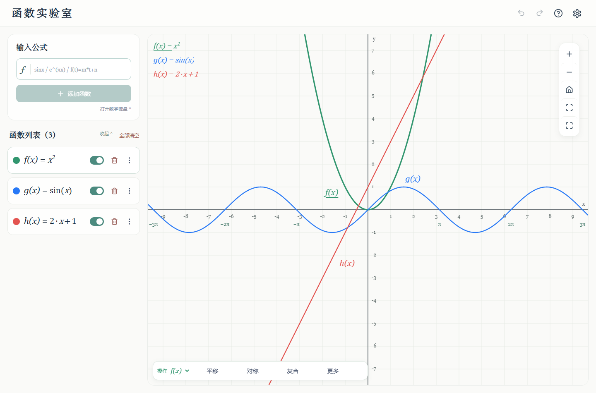

# Function Lab · 函数实验室

**输入一个式子，看见函数如何变化。** 面向数学学习的交互式函数实验台：画图、探索参数、叠加变换、数值分析与几何镜像。无需注册或模型 API Key，桌面与手机均可使用。



## 核心功能

- 即时绘制多个函数，支持数学键盘、隐式乘法、命名函数和复合函数。
- 用滑块探索参数，叠加平移、伸缩、对称和绝对值变换，每次保留生成独立图层。
- 限制定义域，探索零点、交点、导数、切线、法线和可证明的反函数分支。
- 关于任意直线反射函数和观察点，区分几何镜像与单值反函数。
- 拖动画布、滚轮/双指缩放、撤销重做、变换历史、全屏及移动端数学键盘。
- 浏览器自动保存，实验 JSON 导入/导出；核心功能不依赖服务器计算。

## 在线体验与截图

在线体验：[`https://func.hellovian.com`](https://func.hellovian.com)（Cloudflare Workers，HTTPS）。备用入口：[`https://function-lab.hellovian.workers.dev`](https://function-lab.hellovian.workers.dev)。

[桌面截图](docs/images/desktop.png) · [手机截图](docs/images/mobile.png) · [详细使用说明](docs/USAGE.md)

## 快速开始

需要 Node.js 24 LTS 与 npm。

```sh
npm ci
npm run dev
```

打开终端显示的地址，输入 `x^2`、`sin(x)` 或 `1/(x-2)`。按 Enter 保留函数，再从该函数菜单打开变换与分析。`ln(x)`、`log(x)` 均为自然对数，角度使用弧度。

Windows 用户也可先运行 `npm run build`，再双击 `启动函数实验室.cmd` 使用本地构建版本。

## 开发与验证

```sh
npm run check          # 数学/回归测试、ESLint、TypeScript 和生产构建
npm run test:browser   # 启动开发服务后，验收桌面与触屏交互
npm run build
npm run preview
```

浏览器脚本使用 Playwright，默认寻找本机 Chrome；可通过 `LAB_URL` 指定地址。测试截图和日志位于 `.runtime/`，不进入 Git。项目无需 `.env`；部署凭据仅存在 CI secrets 中。

## 技术栈与结构

React 19 · TypeScript · Vite 7 · mathjs · Canvas · Vitest · Playwright · Cloudflare Workers Static Assets

```text
src/components/     画布、函数图层、公式与数学键盘
src/services/       表达式、采样、变换、反函数、分析与持久化
src/utils/          输入、坐标与交互工具
src/tests/          数学和回归测试
public/             静态资源及响应头
scripts/            本地启动与浏览器验收
docs/              使用说明、验收与截图
wrangler.jsonc      Cloudflare 静态资源部署配置
.github/workflows/  GitHub 验证与发布流程
```

## Cloudflare 部署与自动更新

```sh
npm ci
npm run deploy
```

使用 Workers Static Assets，无需数据库或常驻服务器。配置从 `dist/` 发布到网站根路径，支持单页应用回退。

GitHub Actions 对提交执行检查；`main` 检查通过后使用仓库 secrets `CLOUDFLARE_API_TOKEN` 和 `CLOUDFLARE_ACCOUNT_ID` 自动发布。首次连接与域名配置见 [Cloudflare 指南](docs/CLOUDFLARE.md)。

以后本地修改、验证、提交即可：

```sh
git add .
git commit -m "Describe the change"
git push
```

## 数学边界

零点、交点、导数和曲线显示包含数值近似；有限采样不能证明任意表达式的全局性质。完整 `y=x²` 关于 `y=x` 的镜像是关系 `x=y²`，限制为单调分支后才能生成相应反函数。详细约定见 [使用说明](docs/USAGE.md)。

## Roadmap

- [x] 多函数绘图、参数、复合函数与常见变换
- [x] 数值分析、几何反射、实验持久化与移动端布局
- [x] Cloudflare 配置与 GitHub 自动发布工作流
- [ ] 完成首次公开发布与自定义域名验收
- [ ] 更完整的单调区间、值域和渐近线分析
- [ ] 更多教学实验与可分享的实验链接

欢迎提交包含表达式、操作步骤及预期结果的 issue。安全问题见 [SECURITY.md](SECURITY.md)。
